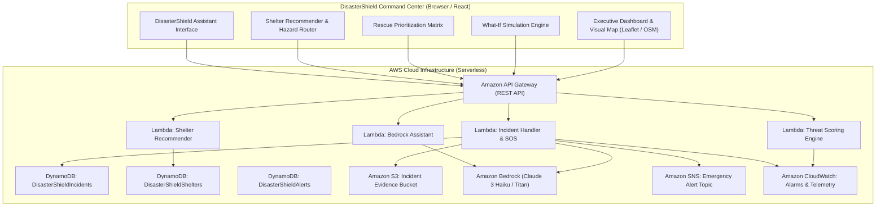

# DisasterShield AI — Smart Disaster Management Platform

> **“Detect Early. Respond Faster. Save Lives.”**

[]()
[]()
[]()
[]()

---

## 1. Executive Summary

**DisasterShield AI** is an emergency command-center platform engineered to empower authorities (DDMA, NDRF, Municipal Corporation of Delhi) and citizens during catastrophic hydrometeorological emergencies. 

While optimized for **urban flooding across the National Capital Territory (NCT) of Delhi**, the modular architecture is hazard-agnostic and ready for severe storms, urban fires, and landslides.

The application features:
- **Interactive Geospatial Disaster Map** with live OpenStreetMap tiles, Delhi floodplains, submerged underpasses, relief camps, and hospitals.
- **Mathematical AI Threat Detection Engine** evaluating rainfall, river level at Old Railway Bridge, drainage vulnerability, and verified reports (0–100 scale).
- **Interactive What-If Disaster Simulator** with real-time sliders and 3 pre-configured scenarios.
- **Citizen SOS Reporting** with duplicate detection, photo upload preview, and automated triage.
- **Rescue Operations Matrix** with algorithmic life-hazard prioritization and team dispatch.
- **Shelter & Evacuation Planner** recommending candidate relief camps while circumventing flooded corridors.
- **DisasterShield AI Assistant** providing Commander SITREP briefings, risk explanations, and safety checklists.
- **Bilingual Interface** supporting English and Hindi (हिन्दी).
- **Interactive 10-Step Guided Hackathon Walkthrough** built directly into the UI header.

---

## 2. System Architecture



---

## 3. Technology Stack

| Layer | Technologies & Services | Role in Platform |
| :--- | :--- | :--- |
| **Frontend** | Vanilla JS / React architecture, CSS3 Glassmorphism | Fast, zero-dependency command center dashboard |
| **Mapping** | Leaflet.js with OpenStreetMap Tiles | Interactive GIS map with custom markers and hazard zones |
| **Scoring Engine** | Standalone mathematical model (`src/scoring.js`) | Multi-factor weighted hydrological threat scoring |
| **Serverless Backend** | Python 3.11 AWS Lambda (`backend/`) | Modular microservices for scoring, SOS, shelters, and AI |
| **API Layer** | Amazon API Gateway | Secure REST endpoints with CORS support |
| **NoSQL Database** | Amazon DynamoDB | High-throughput storage for incidents, shelters, and alerts |
| **Storage** | Amazon S3 | Secure presigned storage for citizen incident photos |
| **Generative AI** | Amazon Bedrock (`anthropic.claude-3-haiku`) | Report summarization, categorization, and assistant co-pilot |
| **Notifications** | Amazon SNS | Critical push alerts to field command units |
| **Monitoring** | Amazon CloudWatch | Latency metrics and critical incident spike alarms |

---

## 4. AI Threat Detection Engine Specification

The urban flood scoring algorithm combines multi-source hydrological, topographical, and citizen telemetry into a calibrated 0–100 index:

$$\text{Threat Score} = \sum (w_i \times N(f_i)) \times \text{Confidence Modifier}$$

### Weight Allocation

| Contributing Feature ($f_i$) | Weight ($w_i$) | Normalization Formula & Telemetry Source |
| :--- | :---: | :--- |
| **Rainfall Intensity** | `0.28` | Piecewise log-linear scaling (0 to 120+ mm/h). Source: IMD Radar. |
| **Yamuna River Water Level** | `0.25` | Baseline 203.0m, Warning 204.5m, Danger 205.33m. Source: CWC Gauge. |
| **Drainage Vulnerability** | `0.15` | Terrain depression score (0–100). Source: MCD/PWD Terrain Cell. |
| **Verified Citizen Reports** | `0.12` | Confirmed waterlogging events (0–25+). Source: DDMA Field Queue. |
| **Flooded Road Closures** | `0.10` | Submerged underpasses / arterial roads (0–8+). Source: Delhi Police. |
| **Official Weather Alert** | `0.10` | Green (5), Yellow (30), Orange (70), Red (100). Source: IMD. |

### Severity Categorization

- **0–24: Low Risk** (Green) — Routine drain inspection.
- **25–49: Moderate Risk** (Amber) — Pre-position municipal dewatering pumps.
- **50–74: High Risk** (Orange) — Restrict vulnerable underpasses; alert relief camps.
- **75–100: Critical Risk** (Red) — Immediate evacuation of Yamuna floodplains; NDRF deployment.

> **Data Integrity Guard:** If primary hydrological sensors (rainfall and river level) are both absent, the system does not silently assume zero risk; it outputs `score: null` with an explicit `CRITICAL_DATA_MISSING` status code and confidence penalty.

---

## 5. Quick Start (Running Locally)

The application includes a zero-dependency local runner that starts in under a second on any Windows, macOS, or Linux system.

### Option A: Node.js (Recommended)
```bash
# 1. Navigate to the project directory
cd disaster-shield

# 2. Run unit tests
npm test

# 3. Start local server
npm start
```
Open **[http://localhost:5173](http://localhost:5173)** in your browser.

### Option B: PowerShell (Windows Native)
```powershell
cd disaster-shield
.\server.ps1
```
Open **[http://localhost:5173](http://localhost:5173)** in your browser.

---

## 6. Three-Minute Guided Hackathon Demo Script

For hackathon judges and evaluators, click the **`🎯 Guided Demo (3 Min)`** button in the top navigation bar to automatically guide through the 10-step story:

1. **Step 1: Command Center Overview** — Review the executive dashboard, Yamuna gauge at 204.8m (Warning Mark breached), IMD status, and summary metrics.
2. **Step 2: What-If Simulator** — Switch to the simulator tab and review the multi-factor sliders.
3. **Step 3: Trigger Extreme Cloudburst** — Click Preset 3 (115 mm/h rain, Yamuna surging to 206.2m). Watch the Delhi Threat Score surge to **94 (Critical)**.
4. **Step 4: Inspect Dynamic Floodplains** — Return to the map. Observe Yamuna Bazar, Kashmere Gate, and ITO glowing red/orange with pulsing danger zones.
5. **Step 5: Citizen SOS Reporting** — Open the SOS modal and submit a simulated flood emergency at Yamuna Bazar with 25 people trapped.
6. **Step 6: Live Queue & Verification** — Notice the new incident instantly appear in the live feed with generated ID `SOS-DEL-XXXX` and "Under Review" status.
7. **Step 7: Rescue Triage Matrix** — Open the Rescue Operations tab. Assign **NDRF 8th Battalion Team Alpha** to the top-ranked life threat.
8. **Step 8: Shelter Evacuation Planner** — Switch to Shelters tab. Request wheelchair-accessible shelters. Click **"Show Safe Route on Map"** to see route corridors circumventing flooded underpasses.
9. **Step 9: DisasterShield AI Assistant** — Ask the assistant to **"Generate Commander Incident Briefing"** and observe the grounded situation report.
10. **Step 10: Reset to Baseline** — Reset simulation to safe seasonal conditions.

---

## 7. AWS Cloud Deployment Instructions

### Prerequisites
- [AWS CLI](https://aws.amazon.com/cli/) configured with deployment credentials.
- [AWS SAM CLI](https://aws.amazon.com/serverless/sam/) installed.
- Python 3.11 installed.

### Step-by-Step Deployment
```bash
# 1. Navigate to backend directory
cd backend

# 2. Build SAM application
sam build

# 3. Deploy to AWS Cloud
sam deploy --guided \
  --stack-name disastershield-ai-stack \
  --region ap-south-1 \
  --capabilities CAPABILITY_IAM
```

### AWS SAM Outputs
Upon completion, the deployment outputs:
- `ApiEndpoint`: REST API Gateway URL (e.g., `https://xxxx.execute-api.ap-south-1.amazonaws.com/prod`)
- `S3BucketName`: S3 bucket for incident evidence media
- `SnsTopicArn`: SNS Topic for emergency broadcast alerts

---

## 8. Unit Test Suite

The mathematical scoring algorithm and edge-case handlers are covered by automated unit tests:

```bash
npm test
```

### Test Coverage Highlights:
- ✅ Normal baseline yields Low risk (< 25)
- ✅ Monsoon heavy rainfall yields High risk (50–74)
- ✅ Extreme cloudburst with danger mark breach yields Critical risk (≥ 75)
- ✅ Normalization functions clamp properly between 0 and 100
- ✅ Missing sensor inputs penalize confidence and trigger warning flags
- ✅ Insufficient data halts score calculation with explicit `CRITICAL_DATA_MISSING` error
- ✅ Risk categorization boundaries adhere to design specifications

---

## 9. Completed Features & Limitations

### Completed Features
- [x] Executive Emergency Command Center Dashboard
- [x] Real-time Interactive Leaflet Map with OpenStreetMap attribution
- [x] Calibrated Multi-Factor Flood Threat Scoring Engine
- [x] Interactive What-If Simulator with Sliders & 3 Presets
- [x] Citizen SOS Reporting Form with Image Upload Preview
- [x] Rescue Operations Multi-Factor Prioritization Matrix
- [x] Relief Shelter Directory with Capacity, Accessibility & Hazard-Avoidance Routing
- [x] DisasterShield AI Assistant (Bedrock-compatible with grounded local fallback)
- [x] In-App Emergency Alert Center with Acknowledge Workflow
- [x] Bilingual Support (English & हिन्दी)
- [x] 10-Step Guided Hackathon Walkthrough Mode
- [x] AWS SAM Infrastructure Template (`template.yaml`)
- [x] 4 Serverless Python Lambda Functions
- [x] Environment Template (`.env.example`) & Seed Data (`sample_data.json`)
- [x] Comprehensive Automated Unit Test Suite

### Known Prototype Limitations
- **Map Routing:** Evacuation routes currently render designated straight-line safe corridors. In production, integrate Amazon Location Service Route Calculator.
- **Simulated Fixtures:** All coordinates, river telemetry, and citizen names represent simulated Delhi test data for prototype demonstration.
- **Notification Delivery:** SMS/Email notifications through Amazon SNS are disabled by default until topic subscribers are confirmed.
